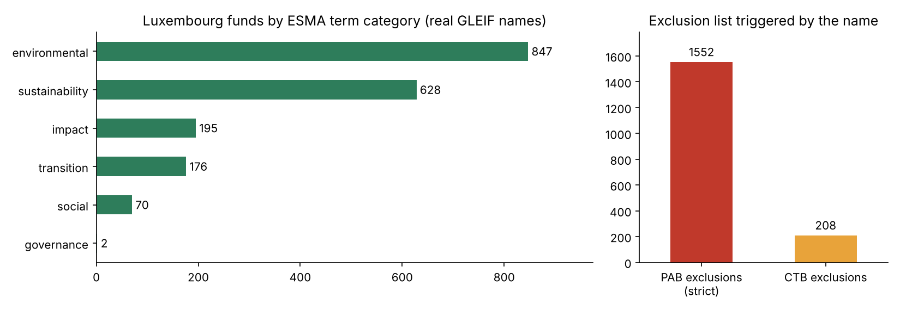

# ESG fund names checker for Luxembourg funds

**Does the fund's name match what the fund holds? A checker for the ESMA Guidelines on funds' names using ESG or sustainability-related terms, applied to 1,760 real Luxembourg fund names from the GLEIF register.**

*Résumé en français plus bas.*

## The problem

Since **21 November 2024** for new funds and **21 May 2025** for existing funds, the ESMA guidelines turn a fund's **name** into binding investment rules. If the name contains an ESG word, the portfolio must meet:

| Term in the name | 80% threshold | Exclusions | Extra condition |
|---|---|---|---|
| Environmental (`green`, `climate`, `ESG`, `SRI`…) | yes | **PAB** (Paris-aligned Benchmark) | – |
| Sustainability (`sustainable`, `durable`, `nachhaltig`…) | yes | **PAB** | meaningful sustainable investments (SFDR art. 2(17)) |
| Impact | yes | **PAB** | positive, measurable impact |
| Transition (`transition`, `net zero`, `improvers`…) | yes | CTB (Climate Transition Benchmark) | clear, measurable transition path |
| Social / Governance | yes | CTB | – |

Environmental + transition terms together: CTB exclusions are enough.

**PAB exclusions** (Delegated Regulation 2020/1818, art. 12): controversial weapons, tobacco, UN Global Compact / OECD violators, and companies with ≥ 1% of revenues from coal, ≥ 10% from oil, ≥ 50% from gas, or ≥ 50% from high-carbon electricity. **CTB** keeps only the first three.

A word in the name therefore decides whether the fund may hold an oil major or a gas utility. Compliance teams must answer three questions for each fund:
1. **Which rules does this name trigger?** Many names mix languages and categories, and many words are traps (`BNP Paribas` is not "Paris-aligned", `Circular Economy` is not an "eco" term).
2. **Does the portfolio comply?**
3. **If not, what is cheaper: selling holdings, or changing the name?**

## What this project does

1. **Real data** (`src/fetch_fund_names.py`): queries the public GLEIF API for every active Luxembourg fund whose name contains one of 50 ESG keywords. Result: 3,846 candidate names. Luxembourg has about 29,500 funds and sub-funds with an LEI.
2. **Name classifier** (`src/name_rules.py`):
   - maps each name to the six ESMA categories, in English, French, German and Italian;
   - applies the combination rules;
   - ignores false friends (`Paribas`, `Economy`, `Greenhill`…);
   - flags thematic names (`water`, `solar`, `clean energy`…) for human review.
3. **Portfolio checker** (`src/portfolio_check.py`):
   - computes the 80% threshold;
   - lists PAB/CTB breaches issuer by issuer;
   - checks the extra conditions.
4. **Option simulator**: compares *keep the name and sell the breaches* (with the turnover cost), *rename as a transition fund*, *drop the sustainability term*, and *leave the scope*.
5. **Generative AI layer** (`src/memo.py`):
   - Claude writes the note to the conducting officers, in French or English, from the computed figures only;
   - the compliance status always comes from the rule engine;
   - without an API key, a template is used.
6. **Streamlit app** (`app.py`) and **17 tests** (`tests/`).

## Results

### 1. Real Luxembourg landscape (GLEIF names, November 2026)



- Out of 3,846 names returned by a keyword search, **1,760 really fall under the guidelines**.
  - The rest is noise: GLEIF's full-text search matches other fields, and words like `Paribas`, `energy` or `future` are not ESG terms.
  - **46** false friends were caught and **95** thematic names are flagged for review.
- **1,552 funds (88%) trigger the strict PAB exclusions**, so a single fossil-fuel holding can make them non-compliant. Only 208 can use the softer CTB list.
- **150 names mix several categories**, for example "Climate Transition" or "Green & Social". For these the combination rules decide the outcome.

Categories overlap, so the bars add up to more than 1,760. Full list: `reports/lu_fund_names_classified.csv`.

### 2. Simulation: what the name costs (synthetic portfolios)

For each type of name, there are 400 portfolios of 60 issuers from a synthetic universe of 426 issuers with realistic sector patterns. The real issuer data (fossil revenues, controversies) is sold by ESG data vendors, so it is simulated here. For comparison, ISS found that 80% of funds with environmental, sustainability or impact terms held at least one PAB-breaching company ([source](https://insights.issgovernance.com/posts/esma-fund-naming-guidelines-a-path-towards-greener-portfolios)).

| Name type | Failing as is | Median turnover to fix the exclusions | Still failing after selling |
|---|---|---|---|
| Environmental | 90% | 3.4% | 0% |
| Sustainability | 87% | 2.2% | 0% |
| Impact | 98% | 2.3% | **72%** |
| Transition | 50% | 0.0% | 10% |
| Social | 44% | 0.0% | 0% |

Reading: for most funds, fixing the exclusions costs a few percent of turnover. **"Impact" is the most fragile word**: selling the breaches is not enough, because the measurable-impact condition applies to 80% of the portfolio. These figures depend on the simulated assumptions; they show how the tool is used, they do not describe real funds.

> Real fund names are used **only** for the name analysis. Portfolio examples use invented names (`Demo … Fund`), so no real fund is said to be in breach.

## Run it

```bash
pip install -r requirements.txt
python src/fetch_fund_names.py   # optional: data already in data/
python src/analyze.py            # landscape + simulation
pytest -q
streamlit run app.py
export ANTHROPIC_API_KEY=...     # optional: notes written by Claude
```

## Limits

- The term lists are an interpretation for screening. The final call on a name belongs to compliance and the CSSF.
- "Meaningful" sustainable investment is not defined by ESMA. The project uses a configurable 10% (`MEANINGFUL_SI`).
- Issuer data is synthetic. In production, plug in an ESG data vendor feed with the same columns.

---

## Résumé en français

**Problème** : depuis 2024-2025, les lignes directrices de l'ESMA transforment le **nom** d'un fonds en règles d'investissement. Un mot comme « durable », « climat » ou « impact » impose 80 % d'investissements alignés et des exclusions (PAB ou CTB) qui peuvent interdire le pétrole, le gaz ou le charbon.

**Solution** :
- **Classificateur multilingue** : il lit le nom du fonds et en déduit les règles qui s'appliquent. Il évite les pièges (« Paribas » n'est pas « Paris-aligned »).
- **Contrôle du portefeuille** : il vérifie le seuil de 80 % et les exclusions, émetteur par émetteur.
- **Simulateur** : il compare vendre les lignes en infraction et changer le nom du fonds.
- **IA générative (Claude)** : elle rédige la note aux dirigeants, sans jamais décider de la conformité.

**Résultats sur données réelles** : sur 3 846 fonds luxembourgeois trouvés par mots-clés (GLEIF), **1 760** sont réellement concernés et **88 %** d'entre eux doivent appliquer les exclusions strictes PAB.

**Compétences** : Python, pandas, API REST, réglementation des fonds (ESMA, SFDR, benchmarks UE), conformité, contrôle de portefeuille, IA générative, Streamlit, tests unitaires.

---
Data: GLEIF, CC0. Author: Martial Bayom.
